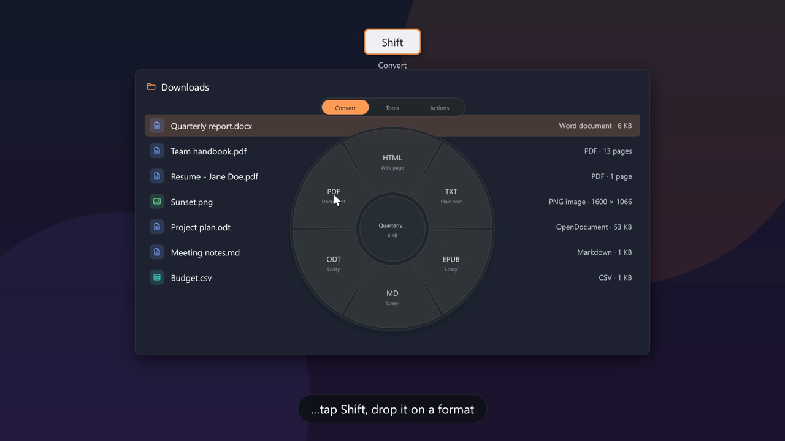
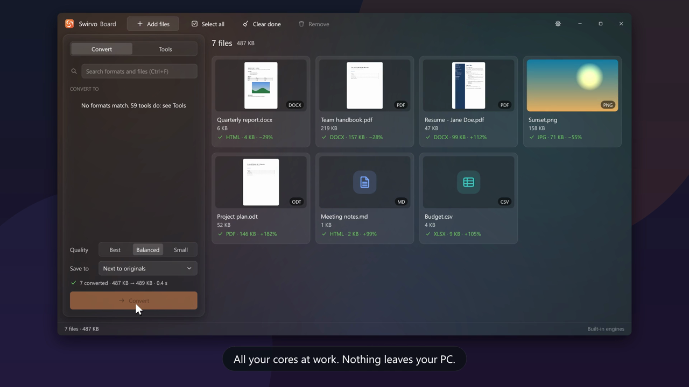
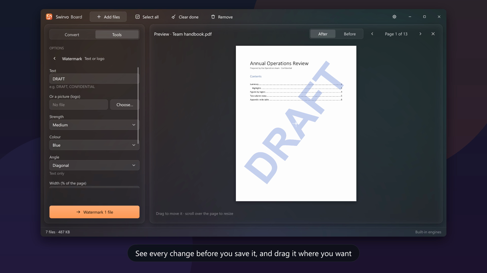

<p align="center">
  
</p>

<h1 align="center">Swirvo</h1>

<p align="center">
  <b>Drag. Tap. Convert.</b> A fast, private file converter and PDF toolkit for Windows.<br>
  Everything runs on your PC: no upload, no account, no telemetry.
</p>

<p align="center">
  <a href="https://apps.microsoft.com/detail/9NPGWFBVTDJQ"></a>
</p>

<p align="center">
  <a href="https://github.com/Nabarup1/swirvo/releases/latest">Other downloads</a> ·
  <a href="media/swirvo-demo.mp4">Watch the 50-second demo</a> ·
  <a href="#what-it-can-do">Features</a> ·
  <a href="#use-it-from-ai-assistants-mcp">For AI assistants</a> ·
  <a href="#build-from-source">Build from source</a>
</p>



## How it works

1. **Start dragging any file**: in File Explorer, on the desktop, anywhere.
2. **Tap a key** while you hold it: **Shift** for formats, **Ctrl** for tools, **Alt** for actions.
3. **Drop it on a wedge.** The result is saved next to the original, usually before you've let go of the mouse. **Your original is never changed.**

No dialog, no app to open, no website to upload to.

## What it can do

**The Board** is the full workspace behind the wheel. Drop in a whole folder, give every file its own target format and convert them all at once, in parallel across your CPU cores. Search any format or tool with **Ctrl+F**.



**About 96 formats (138 file extensions)**

| Category | Highlights |
|---|---|
| Images | PNG, JPG, WebP, TIFF, BMP, GIF, ICO, TGA, QOI; also opens SVG, JPEG XL, HEIC, AVIF, PSD and camera RAW |
| Documents | PDF, DOCX, ODT, RTF, EPUB, Markdown, HTML, TXT. **PDF → Word rebuilds the layout** (fonts, columns, tables, pictures). **Word, Excel and PowerPoint → PDF without Office installed**, optionally as PDF/A or tagged PDF |
| Data | XLSX, CSV, TSV, JSON, YAML, TOML, XML, NDJSON; PDF tables → Excel |
| Media | MP4 → MP3 and other audio through Windows' built-in media engine; video compression to a target size; FFmpeg is used automatically if you have it |
| Other | Fonts (TTF, OTF, WOFF, WOFF2), subtitles (SRT, VTT, ASS), archives (ZIP, TAR, GZ, XZ, BZ2, ZST; 7Z, RAR and ISO through Windows) |

**59 tools**, 35 of them for PDF:

- **PDF:** merge; split by page, every N pages, at bookmarks, by size or into **your own page ranges**; rotate; pick, reorder and delete pages; pages → images; compress; page numbers; header and footer; Bates numbering; watermark; password protect and unlock (AES-256); trim, crop, resize; N-up and booklet; remove hidden data; repair; bookmarks from headings; save pictures and attachments; **OCR** to make scans searchable; **redaction** that removes the text, not just covers it; grayscale; form fields to a spreadsheet, fill forms per row, flatten; **compare**; **digital signatures** with your own certificate, and verifying them; PDF/A.
- **Word:** compress, clean author and tracked changes, find and replace, save pictures, word count, **mail merge**.
- **Images:** resize, fit 1920, rotate, flip, compress, strip GPS and camera info, images → one PDF.
- **Video:** save a frame, compress to a size.
- **Files:** extract archives, test an archive, SHA-256 checksum, to ZIP, copy text (with OCR for photos and scans).

**Live previews:** watermark, crop, redaction, page numbers and more show the result before you save. Drag the watermark where you want it; crop every page or just one.



## Private and safe by design

- **Nothing leaves your PC.** No network code, no account, no ads, no analytics. See the [privacy policy](PRIVACY.md).
- **Originals are never modified.** Results are new files, written atomically, never overwriting anything.
- **Sandboxed conversions.** Every conversion runs in a separate worker process with a memory cap, so a damaged file can't take the app down.
- **No admin rights needed**, no drivers, no services. Uses what Windows already has (OCR, image codecs, Media Foundation, `tar.exe`) instead of bundling big libraries.

## Download

- **Windows 10 and 11 (recommended): [Swirvo on the Microsoft Store](https://apps.microsoft.com/detail/9NPGWFBVTDJQ).** Free, signed by Microsoft, updates itself, and puts the `swirvo` command on your PATH.

Or get the latest **[release](https://github.com/Nabarup1/swirvo/releases/latest)** from GitHub:

- **Windows 10 (1809 or later) and 11, x64:** `Swirvo-<version>-windows-x64.zip`. Unzip, double-click `Swirvo.exe`, and it offers to install itself for your user (Start menu, Settings → Apps, start with Windows; no admin). The Swirvo icon appears in the notification area.
- **Linux x64:** `swirvo-cli-<version>-linux-x64.tar.gz`, the `swirvo` command-line tool. The Linux desktop app (wheel and Board) isn't ready yet.

**"Windows protected your PC"?** The GitHub downloads aren't code-signed yet, so SmartScreen warns about them. Click **More info → Run anyway**, or install from the [Microsoft Store](https://apps.microsoft.com/detail/9NPGWFBVTDJQ) instead, which has no warning.

### Command line

```bash
swirvo convert report.pdf --to docx
swirvo tool pdf-merge a.pdf b.pdf
swirvo tools photo.jpg
swirvo formats --supported
```

## Use it from AI assistants (MCP)

**Claude Desktop:** download `Swirvo-<version>.mcpb` from the [latest release](https://github.com/Nabarup1/swirvo/releases/latest) and double-click it. That's it.

Other assistants: `swirvo mcp` turns Swirvo into a local [MCP](https://modelcontextprotocol.io) server, so Claude Desktop, Claude Code, Cursor, VS Code and other AI assistants can convert files, run the PDF tools and read documents (with OCR) on your PC. No API key, nothing uploaded, originals never touched.

```json
{
  "mcpServers": {
    "swirvo": {
      "command": "swirvo",
      "args": ["mcp"]
    }
  }
}
```

Tools: `convert_files`, `run_tool`, `extract_text`, `list_tools`, `list_formats`, `detect_format`. Listed in the official [MCP Registry](https://registry.modelcontextprotocol.io) as `io.github.Nabarup1/swirvo`; a Claude plugin with a usage skill is in [`plugin/`](plugin). Setup for each client: [docs/19](docs/19-ai-assistants-mcp.md).

## Build from source

Rust (stable, 2024 edition) on Windows or Linux:

```bash
cargo build --release -p swirvo-cli
```

```bash
cargo run -p swirvo-cli -- convert photo.png --to webp
```

The Windows app (`swirvo-agent`, shipped as `Swirvo.exe`) builds natively on Windows with the MSVC toolchain:

```bash
cargo build --release -p swirvo-platform-win -p swirvo-cli
```

From WSL, `scripts/build-windows-exe.sh` builds a standalone `dist/Swirvo/` using the Windows-side Visual Studio Build Tools. Releases are built by [GitHub Actions](.github/workflows/release.yml) from a version tag.

Checks: `cargo fmt --all`, `cargo clippy --workspace --all-targets --all-features -- -D warnings`, `cargo test --workspace`, `cargo deny check`. See [CONTRIBUTING.md](CONTRIBUTING.md) and [PROJECT_GUIDE.md](PROJECT_GUIDE.md).

## How it's built

A Rust workspace with its own engines and its own UI toolkit (no web view):

| Crate | What it does |
|---|---|
| `crates/formats` | Format registry and content detection (signature trie, container probes, text sniffing) |
| `crates/graph` | Conversion planner: Dijkstra per quality preset over a capability graph, with route explanations |
| `crates/wheel` | Wheel geometry, hit-testing, gesture state machine, frecency with stable slots (property-tested) |
| `crates/engines` | Pure-Rust engines: images, PDF, the PDF → DOCX layout rebuilder, the DOCX/XLSX/PPTX → PDF layout engines, data, fonts, archives, plus the Windows OS engines |
| `crates/jobs` | Parallel batches, the tools, never-overwrite naming, atomic commits, the sandboxed worker |
| `crates/render`, `crates/ui` | The wheel renderer and a small immediate-mode UI toolkit on tiny-skia |
| `crates/board` | The Board, the page picker and the live previews |
| `crates/platform/win` | The Windows app: Raw Input triggers, the OLE drag probe, the layered wheel window, tray, installer |
| `crates/cli` | The `swirvo` command-line tool and the MCP server (`swirvo mcp`) |

Design docs:

| Doc | What's inside |
|---|---|
| [01 · Product spec](docs/01-product-spec.md) | Personas, principles, ways to invoke the app, the catalog of conversions, tools and actions |
| [02 · UX & UI spec](docs/02-ux-ui-spec.md) | Wheel anatomy, gestures, state machine, motion, accessibility, screens, design tokens |
| [03 · System architecture](docs/03-system-architecture.md) | Process model, crate layout, job lifecycle, workers and sandboxing, storage, security |
| [04 · Algorithms](docs/04-algorithms.md) | Format detection, conversion planning, frecency, radial hit-testing, scheduling, PDF reconstruction |
| [05 · Conversion engines](docs/05-conversion-engines.md) | Techniques per category, default settings, the engine matrix with licences |
| [06 · Platform integration](docs/06-platform-integration.md) | The Windows gesture pipeline, overlay compositing; the Linux plan for X11 and Wayland |
| [07 · Performance, testing & release](docs/07-performance-testing-release.md) | Latency budgets, test strategy, fuzzing, CI |
| [08 · Roadmap & risks](docs/08-roadmap-risks.md) | Phases and risk register |
| [10 · Formats & conversions](docs/10-formats-and-conversions.md) | Every format and conversion, and how each is done |
| [11 · Tools & features](docs/11-tools-and-features.md) | Tools and actions on the wheels and the Board |
| [12 · Board & UI](docs/12-board-and-ui.md) | The Board, the page picker, the UI toolkit |
| [13 · PDF reconstruction](docs/13-pdf-reconstruction.md) | PDF → DOCX that keeps the layout |
| [16 · DOCX → PDF](docs/16-docx-to-pdf.md) | The built-in Word layout engine |
| [17 · PDF and document tools](docs/17-pdf-and-document-tools.md) | Compress, stamps, pages, protection, clean-up, the options system |
| [19 · AI assistants (MCP)](docs/19-ai-assistants-mcp.md) | `swirvo mcp`: tools and setup for Claude Desktop, Claude Code, Cursor, VS Code |

## Licence

- **The app** (the official downloads and the Microsoft Store version) is **free to use, at home and at work**: [EULA.md](EULA.md).
- **The source code** is available under the [PolyForm Noncommercial License 1.0.0](LICENSE.md): you may read, build, change and share it for any **noncommercial** purpose. Commercial use of the code needs a separate licence from the author; ask through [Issues](https://github.com/Nabarup1/swirvo/issues).
- **The name Swirvo and its logo** are not licensed for use by others: [TRADEMARKS.md](TRADEMARKS.md).
- Open-source components keep their own licences, listed in `THIRD-PARTY-NOTICES.txt` with every download.

Product and format names (Microsoft Word, Excel, PowerPoint, Windows, PDF and others) belong to their owners and are used only to describe compatibility. Swirvo isn't affiliated with or endorsed by any of them.

Made by [Nabarup Ghosh](https://github.com/Nabarup1).
