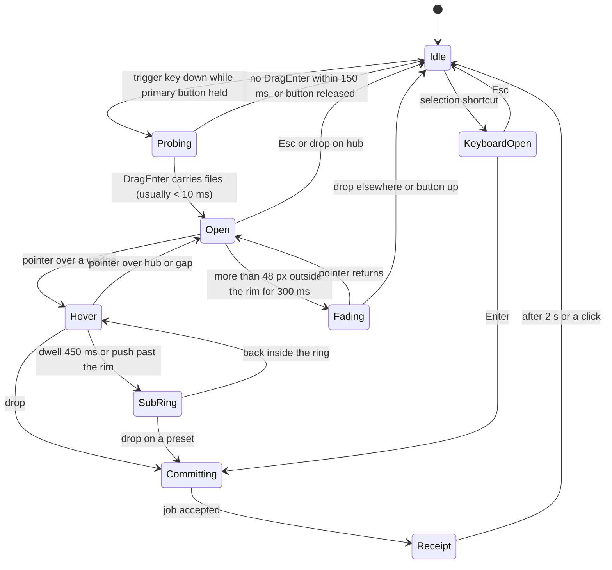

# 02 · UX & UI spec

The interactive prototype (link in the README) implements the wheel behavior described here. When this doc and the prototype disagree, this doc wins.

## 1. UX principles

1. **One gesture, no dialogs.** Drag, tap, drop. Anything optional is one dwell away, never a modal.
2. **Spatial stability.** A format stays where it was yesterday. Muscle memory beats a "smart" ordering that reshuffles.
3. **Show the outcome before committing.** Hovering a wedge shows the output name, an estimated size and the technique ("lossless remux").
4. **Forgiving.** Esc, dropping on the hub, or releasing elsewhere cancels. Every result has Undo.
5. **Quiet.** Short jobs confirm with a small receipt that fades away; only long jobs and errors raise notifications.
6. **Native.** Fluent 2 on Windows 11, Adwaita/Breeze-aware on Linux; follows the system accent, theme, contrast, motion and transparency settings.
7. **Equivalent paths.** Pointer, keyboard, touch and screen reader can each do everything.

## 2. Surface map

| Surface | Lives in | When it appears |
|---|---|---|
| **Wheel** (Convert / Tools / Actions) | Agent overlay (native) | During a drag after the trigger; on the selection shortcut; from a context-menu entry |
| **Receipt bubble** | Agent overlay | 2 s after a short job (< 3 s), where the wheel was |
| **Toast notification** | OS notification center | Long jobs (progress), batches, errors |
| **Tray flyout** | Agent (native) | Click on the tray icon: drop zone, active and recent jobs |
| **Board** | `Swirvo.exe --board` (native, docs/12) | Batch convert and tools today; Queue, History, Recipes, Watch folders, Engines, Settings later |
| **Tool editors** | Hub windows | Tools that need input: Trim, Crop, Annotate, Redact, PDF Organizer, Metadata, Bleep |
| **Shelf** | Agent overlay | *Float* action; holds files to drag out later |
| **Command bar** | Agent overlay | Global shortcut |
| **Onboarding** | Hub | First run |

## 3. The wheel

### 3.1 Anatomy and geometry (100 % scale)

| Element | Value | Notes |
|---|---|---|
| Outer radius `R` | 156 px | 312 px diameter; overlay window 380 × 400 px including shadow and tab pill |
| Hub radius `r₀` | 50 px | File thumbnail or type glyph, short name, count badge for multiple files |
| Wedge band | 56 → 156 px | 100 px deep, so effectively infinite in the drag direction (Fitts's law) |
| Wedges per ring | 2–8 | 45° each at 8. Eight compass directions are the fastest to hit without looking |
| Gap between wedges | 3 px | Gaps count as "no selection" |
| Wedge label | 15 px semibold format code, 11 px caption | Centered at radius ≈ 0.64 R |
| Wedge icon | 20 px | Above the label |
| Preset sub-ring | 164 → 220 px | Opens outward from the hovered wedge |
| Tab pill | 28 px tall, 12 px above the rim | `⇧ Convert · Ctrl Tools · Alt Actions`; doubles as a pointer switcher |
| Minimum target | ≥ 44 × 44 px effective | Holds at 8 wedges |
| Sizes | S 0.85× · M 1.0× · L 1.2× | Multiplied by the monitor's DPI scale |

### 3.2 What a wedge shows
- **Label**: the target (`JPG`), plus a caption saying what it's good for (`Smaller · universal`).
- **Hover bubble**: `IMG_2041.jpg · ≈ 2.1 MB (−38 %) · libvips · quality 85`. The estimate comes from the learned size model ([04](04-algorithms.md) §10) and needs no encoding work.
- **Badges**: ⬇ *needs the Media pack (38 MB)*; ⚠ *transparency becomes white*; 🔒 *password needed*.

### 3.3 Order and stable slots
- Slot 0 is at 12 o'clock; slots run clockwise.
- When more than 8 targets exist, slot 7 becomes **More…** and opens an outer ring of up to 16 more. In keyboard mode, typing filters the list.
- **Pinned slots**: the user pins, say, JPG to 12 o'clock for HEIC. A pin applies per input format or per category.
- **Auto slots** fill from decayed frecency, with hysteresis: at most one swap per context per day, and only when the challenger is clearly ahead ([04](04-algorithms.md) §3).
- **Cold start** uses shipped priors: HEIC → JPG, PNG → WebP/JPG, MOV → MP4, PDF → DOCX, DOCX → PDF, WAV → MP3.

### 3.4 Presets
- Convert sub-ring: **Best · Balanced** (default on a plain drop) **· Smallest · Custom…**
- Compress (video): **10 MB · 25 MB · 50 MB · Custom…**, labelled with common uses ("email", "Discord")
- Resize: **50 % · 1920 px · 1080 px · Custom…**
- *Custom…* opens a small options popover at the drop point after the drop. It is never a full window.

### 3.5 Switching wheels
A modifier tap, **Tab** (cycles forward), the mouse wheel, or resting on a tab in the pill for 250 ms (needed on Wayland and touch, where modifiers can't be observed). The switch animates as a 140 ms crossfade with an 8° rotation, so the change is noticeable without being distracting.

### 3.6 Several files
- The hub shows a stack of three cards and a count.
- **Convert** shows the targets every input can reach (set intersection, [04](04-algorithms.md) §2).
- Mixed categories with nothing in common show a **Per type…** wedge (a compact mapping popover after the drop) plus smart combinations: *Combine to PDF* (images + PDFs), *ZIP all*.

### 3.7 Placement
- The wheel is centered on the pointer and clamped into the monitor's work area with a 12 px margin. When it's clamped, direction is measured from the hub, not from the pointer.
- Per-monitor DPI v2. Opening never steals focus or activates a window.
- The wheel is suppressed while a full-screen exclusive app or game runs, or during presentation mode.

### 3.8 Ways to cancel
Drop on the hub · **Esc** (also cancels the OS drag) · release anywhere outside the wheel · stay more than 48 px outside the rim for 300 ms. The wheel then fades out, the drag continues normally, and you can still drop on a folder.

### 3.9 State machine

### 3.10 Motion

| Moment | Duration | Curve | Reduced motion |
|---|---|---|---|
| Open | 120 ms: scale 0.92 → 1, opacity 0 → 1 | decelerate `cubic-bezier(0.1, 0.9, 0.2, 1)` | opacity only, 80 ms |
| Wedge hover | 80 ms: fill, plus 4 px outward | standard `cubic-bezier(0.8, 0, 0.2, 1)` | color only |
| Sub-ring | 160 ms, 20 ms stagger per item | decelerate | instant |
| Switch wheel | 140 ms crossfade, 8° rotation | standard | crossfade |
| Commit | 180 ms: wedge pulse, then the wheel collapses into a 28 px progress ring | accelerate `cubic-bezier(0.7, 0, 1, 0.5)` | fade |
| Dismiss | 100 ms | accelerate | instant |

On Windows, open, close and switch animations run inside DWM as composition animations, so they stay smooth even when the agent is busy.

### 3.11 Feedback during the drag
- **Windows:** the drag tooltip next to the cursor reads *Convert to JPG* (a drop description set on the data object). The drop effect is always **Copy**, never Move, so the source is never deleted.
- Sound is off by default. Haptics are out of scope.

### 3.12 Errors inside the wheel
- An unknown type shows *No conversions for .xyz* in the hub; Tools and Actions still work.
- A missing engine shows a ⬇ badge on the wedge. Dropping on it asks once (*Download Media pack, 38 MB?*) and then runs the job.
- Locked, offline or protected files are flagged in the hover bubble before the drop.

### 3.13 Accessibility
- The overlay exposes a menu tree through **AccessKit**: UI Automation on Windows, AT-SPI on Linux. Moving between wedges announces *Convert to JPG, 1 of 8*.
- Keyboard mode: arrows move between wedges (←/→ rotate, ↑/↓ change ring), **Enter** applies, **Tab** switches wheel, typing filters, **Esc** closes.
- High contrast: use system colors only, with no transparency.
- Follows the OS settings for reduced motion and transparency effects. Text scales with the OS text-size setting.
- Wedges never rely on color alone; every wedge carries an icon and a label.

## 4. Receipts and notifications

| Job | Feedback |
|---|---|
| < 3 s | Receipt bubble at the drop point: `✓ IMG_2041.jpg · 2.1 MB` with **Show** and **Undo**. Hovering pauses its 2 s timer |
| ≥ 3 s | Toast with a progress bar and ETA range; at the end **Show in folder · Open · Undo** |
| Batch | One toast per batch: *12 of 48 · about 1 min left*. Summary: *48 converted · 2 failed · View* |
| Error | Toast naming the cause and the fix (§12) |

Setting: *Notify me* → Always / **Long jobs and errors** (default) / Errors only. The OS's Do Not Disturb applies.

## 5. Tray flyout (360 × 480)
Header (Swirvo · pause toggle · settings) → drop zone → **Active** (progress rows) → **Recent** (last 10: thumbnail, name, size change; click to show in folder; context menu: Re-run, Undo, Copy CLI command) → footer *Open Swirvo*.

## 6. Hub app

Window 1100 × 720 by default, minimum 720 × 500. On Windows 11: Mica, a custom title bar and a left NavigationView.

| Section | Content |
|---|---|
| **Home** | A large drop zone ("…or drag any file anywhere and tap Shift"), quick-convert chips from frecency, recent results grid, one contextual tip ("You converted 23 HEIC photos this week. Make a watch folder for phone uploads?") |
| **Queue** | Groups Running / Waiting / Paused / Finished today. Each row: thumbnail, name, operation chip (`HEIC → JPG · Balanced`), progress, ETA range, resource chip (GPU/CPU), pause, cancel, move up. The header shows the capacity in use: `CPU 4/8 · GPU encoders 1/3 · RAM 1.2/6 GB` and the battery policy |
| **History** | Full-text search, filters (date, type, status), source → output, size change, duration, technique. Actions: Show, Open, Re-run with…, Undo (moves the output to the Recycle Bin), **Copy as CLI command** |
| **Recipes** | List plus an editor: a reorderable step list, a test run on a sample, a "Show in Tools wheel" toggle and slot |
| **Watch folders** | Folder · recipe · status · last run · processed count. An add flow, pause and resume |
| **Engines** | Packs with status, version, size and license; *Use system FFmpeg* on Linux; detected hardware (e.g. `GTX 1650 Ti · NVENC H.264/HEVC`, `UHD 630 · Quick Sync H.264/HEVC`); a self-test button |
| **Settings** | See §11 |

## 7. Tool editors

The editors share one shell. Title bar with the file name → canvas → inspector on the right (280 px) → bottom bar with the output estimate, **Cancel** and **Save as new ▾** (with *Replace original…* behind a confirmation). Every editor opens within 400 ms (the webview is warmed ahead of time, [03](03-system-architecture.md) §4) and follows a common keymap: Space play/pause, I/O set in/out, J/K/L shuttle, Ctrl+Z undo, Enter save.

| Editor | Specifics |
|---|---|
| **Trim** | Preview frame, filmstrip with keyframe ticks, waveform, in/out handles with `HH:MM:SS.mmm`. Mode: **Smart cut** (default: lossless middle, re-encoded edges), *Fast* (snaps to keyframes), *Exact* (full re-encode). Multiple segments in P3 |
| **Crop** | Aspect presets (Free, 1:1, 4:5, 16:9, 9:16, 3:2), rule-of-thirds overlay, numeric fields, straighten slider |
| **Annotate** | Select, arrow, rectangle, ellipse, line, pen, highlighter, text, numbered step, blur/pixelate. Output is flattened; the original is kept |
| **Redact** | Auto-detect toggles: faces, emails, phone numbers, card numbers, custom word list. Suggested boxes can be accepted or rejected. Styles: black box, blur, pixelate. PDFs get a notice: *True redaction removes the text and images under the boxes; this can't be undone in the new file* |
| **PDF Organizer** | Page grid, zoom, multi-select, drag to reorder, rotate, delete, insert from a file, split markers between pages, extract the selection. Output: one PDF or several |
| **Metadata** | Grouped fields: camera, dates, location (coordinates only, since showing a map would need the network), author/copyright. *Remove all but orientation and color profile*. Applies to batches |
| **Bleep** (P3) | Transcript with word timestamps; click words to bleep; find-and-bleep list; tone or silence |

## 8. Shelf
A floating panel, 280 px wide, that docks to a screen edge and hides itself as a 6 px tab. It holds **references**, not copies. Stack, grid and list views. Files drag out to any app. Right-click opens the wheels on shelf items. Shelves persist across restarts (optional).

## 9. Command bar
640 px wide, centered near the top of the screen. The input shows the target files as a chip (`3 files from Downloads`). Results are fuzzy-matched and grouped (Convert, Tools, Actions, Recipes); Enter runs, Tab shows options. The equivalent CLI command appears in the footer.

## 10. Onboarding (first run)
1. **Welcome**: "Convert anything with one gesture", plus the privacy promise in three lines.
2. **Practice**: a playground with a sample photo. "Drag the photo, tap Shift, drop on JPG." A check mark, then "Try Ctrl for tools and Alt for actions."
3. **Modifier conflict**: "Do you hold Shift or Ctrl while dragging to move or copy files?" → *No, single tap* / *Yes, use double-tap*.
4. **Integrations**: right-click menu ✓ · start with Windows ✓ · hot corner ☐ · Media pack download if it's missing (size shown).
5. **Done**: where the tray icon is, including how to keep it out of the overflow area on Windows 11.

## 11. Settings
- **General**: start at login, language, theme, notifications
- **Wheel & gestures**: triggers and remapping, single or double tap, drag-dwell, hot edges and corners, size, Glass/Solid style, sub-ring dwell time, pinned-slot editor
- **Output**: location rule, naming templates, collisions, metadata policy, keep original dates
- **Formats & quality**: per-format defaults (JPEG quality, WebP lossless for graphics, video codec order…)
- **Performance**: concurrency, GPU on/off per vendor, battery policy, background priority
- **Integrations**: context menu, Send To, terminal choice, file-manager extensions (Linux)
- **Shortcuts**: selection shortcut, command bar
- **Privacy**: Offline mode, update checks, crash reports
- **Advanced**: logs, diagnostics bundle, reset; **About**: versions and third-party licenses

## 12. Output and naming

- **Location:** next to the source. If that fails (read-only folder, protected folder, offline cloud file), save to `Downloads\Swirvo` and say so in the receipt.
- **Names:** conversions keep the stem (`IMG_2041.jpg`); tools add a suffix (`talk-compressed.mp4`, `scan-redacted.pdf`); collisions get a number the way Explorer does it (`IMG_2041 (2).jpg`). Template tokens: `{name} {ext} {tool} {preset} {date} {time} {w}x{h} {n}`.
- **Dates:** outputs get the current time; *Keep original dates* is an option (useful for photo libraries).
- **Metadata:** kept by default when converting. Location is removed by default for Share and Send. A global *Always remove location* setting exists.

## 13. Edge cases

| Situation | Behavior | Copy |
|---|---|---|
| Source folder is read-only | Save to Downloads\Swirvo | "Couldn't save next to the original because the folder is read-only. Saved to Downloads\Swirvo." **Show** |
| OneDrive file is online-only | Download it first, with progress | "Downloading from OneDrive… 34 %" |
| File is open in another app | Retry; name the app (Windows Restart Manager) | "Contract.docx is open in Word. Close it and press Retry." **Retry** |
| Not enough disk space | Checked before starting, using the size estimate | "This needs about 2.4 GB, but C: has 1.1 GB free." **Choose another drive** |
| Damaged or unsupported file | Fail fast with the reason | "This file looks damaged: the video header is missing." |
| Password-protected PDF or ZIP | Ask; never stored unless the user opts in | "Enter the password for Contract.pdf" |
| More than 1,000 files | Confirm once, with an ETA | "Convert 1,240 files to WebP? About 3 min." **Start** · **Options** |
| Copy-protected media | Refuse | "This file is copy-protected, so Swirvo can't convert it." |
| Network share | Allowed; slow I/O shows in the ETA | — |
| Path longer than 260 characters | Supported | — |

## 14. Visual design tokens

| Token | Light | Dark | Use |
|---|---|---|---|
| `accent` (Swirvo orange) | `#E8772E` | `#FF9A57` | Brand, Convert wheel, primary buttons |
| `accent-hover` / `-pressed` | `#D96A22` / `#C45F1E` | `#FFAD75` / `#FFC093` | |
| `wheel-tools` (Teal) | `#0E8A84` | `#3CC9C0` | Tools wheel |
| `wheel-actions` (Indigo) | `#5B5FD6` | `#9094F7` | Actions wheel |
| `surface` | `#FFFFFF` (Mica/Acrylic when available) | `#202020` | Windows, flyouts |
| `wheel-glass` | `rgba(249,249,249,0.72)` + backdrop blur | `rgba(32,32,32,0.70)` + backdrop blur | Wheel band (Glass style) |
| `wheel-solid` | `#F7F7F7` | `#2B2B2B` | Solid style; also Windows 10 |
| `text` / `text-2` | `rgba(0,0,0,.90)` / `rgba(0,0,0,.62)` | `#FFFFFF` / `rgba(255,255,255,.79)` | |
| `success` / `warning` / `error` | `#0F7B0F` / `#9D5D00` / `#C42B1C` | `#6CCB5F` / `#FCE100` / `#FF99A4` | Semantic only, never decorative |

- **Type:** Segoe UI Variable on Windows 11 (Segoe UI on 10). On Linux, the desktop's UI font, falling back to the bundled Inter (OFL). Monospace: Cascadia Mono or the system monospace. Ramp (Fluent 2): Caption 12/16 · Body 14/20 · Body Strong 14/20 semibold · Subtitle 20/28 · Title 28/36 · Display 68/92.
- **Spacing:** 4 px grid (4, 8, 12, 16, 24, 32, 48). **Radii:** 4 px controls, 8 px cards, flyouts and windows, 10 px wedge corners.
- **Elevation:** flyout `0 8px 16px rgba(0,0,0,.14)`; wheel `0 16px 32px rgba(0,0,0,.24)` plus a 1 px inner stroke.
- **Durations:** 80 / 160 / 250 ms. **Curves:** decelerate, accelerate and standard as in §3.10.
- **Icons:** Fluent System Icons (MIT), 20 px regular, filled when selected. File-type glyphs are custom and tinted by category.

### 14.1 App icon

**The Swirvo mark:** a rounded square in the accent gradient (`#F79A45` top left → `#D9482B` bottom right) with three white blades curling clockwise out of a centre dot. It reads as a swirl (the name) and as the wheel turning a file into something else. It is ours alone: no arrows-in-a-circle (that reads as "refresh" or recycling), nothing borrowed from another product.

- **One geometry** (`crates/render/src/icon.rs`, a 256 × 256 design space) feeds everything, so nothing can drift: the tray and title-bar icons (`render::app_icon`, drawn with tiny-skia at the exact pixel size) and the exported files.
- **Small sizes (≤ 24 px)** use a simpler variant: the square fills more of the canvas, the blades are wider and reach full width sooner, and there's no centre dot. That keeps it a clear pinwheel at 16 px in the tray and taskbar.
- **Files** (`cargo run -p swirvo-render --example icon_assets`): `packaging/icon/swirvo.svg` and `swirvo-small.svg`, PNGs from 16 to 512 px, `swirvo.ico` (16–256 px), and the Store tile set in `packaging/msix/Assets/` (targetsize and scale variants, including the unplated taskbar ones). `SWIRVO_ICON_PREVIEW=sheet.png` also writes a zoomed contact sheet for checking small sizes by eye.
- **The exe's own icon and version info** come from `packaging/icon/swirvo.res` (`scripts/build-res.sh`, which runs the Windows SDK's rc.exe), linked into `Swirvo.exe` and `swirvo-cli.exe` by their build scripts.

## 15. Platform adaptation

| | Windows 11 | Windows 10 | GNOME | KDE Plasma |
|---|---|---|---|---|
| Wheel style | Glass (host backdrop blur) | Solid | Solid | Glass through KWin blur |
| Hub chrome | Mica, custom title bar | Solid | Header bar, libadwaita feel | Breeze feel |
| Accent | System or Swirvo orange | System or Swirvo orange | Portal accent color (GNOME 47+) | Portal or kdeglobals |
| Font | Segoe UI Variable | Segoe UI | Adwaita Sans / Cantarell | Noto Sans |
| Tray | Notification area | Notification area | AppIndicator if present; otherwise the Hub | StatusNotifierItem |

## 16. Copy and localization
- **Voice:** short, concrete, active. Buttons say what happens (*Convert*, *Show in folder*). Errors say what happened and what to do.
- Examples: "Converted to JPG · 2.1 MB" · "Needs the Media pack (38 MB). Download?" · "Paused while on battery. Resume?"
- **i18n:** Project Fluent (`fluent-rs` in Rust, `@fluent/bundle` in the Hub). ICU plural rules, pseudo-localization in CI, and a mirrored Hub layout for RTL. Wheel slots keep their positions in RTL (spatial memory); only text alignment flips.
